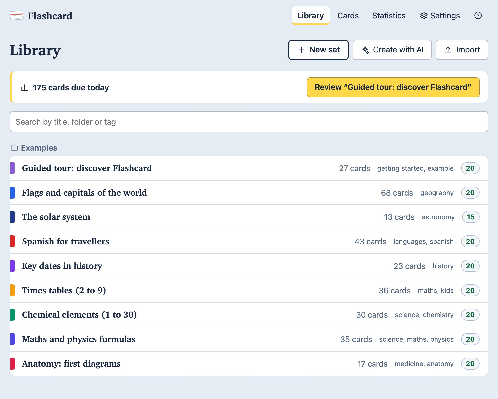
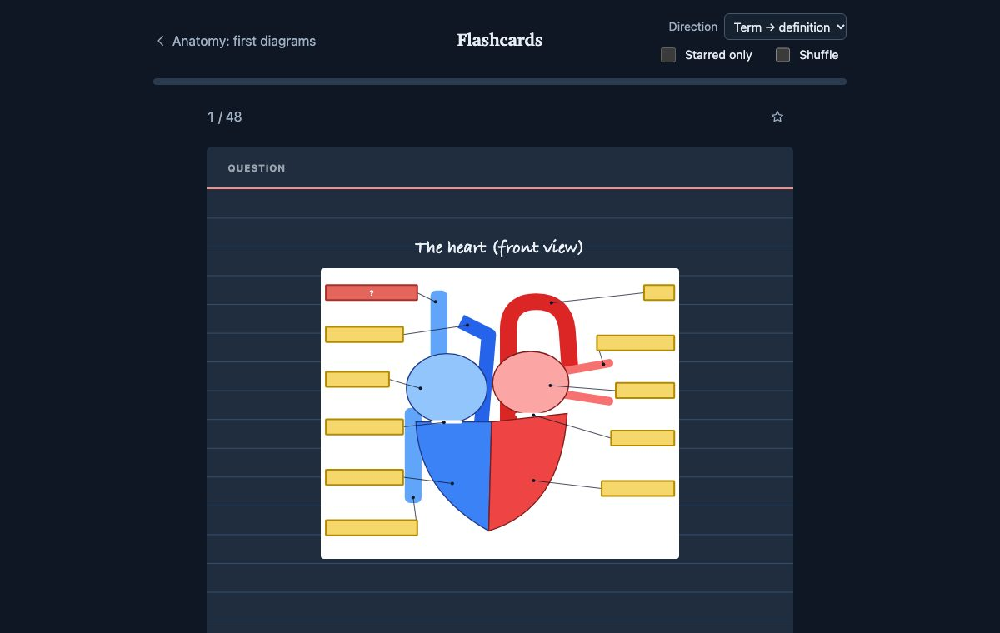
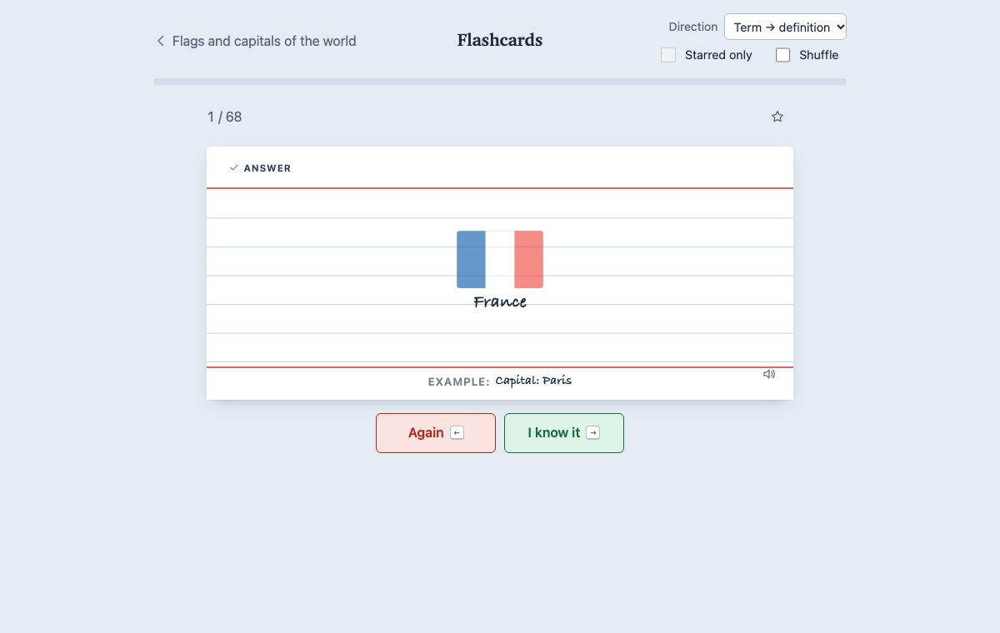
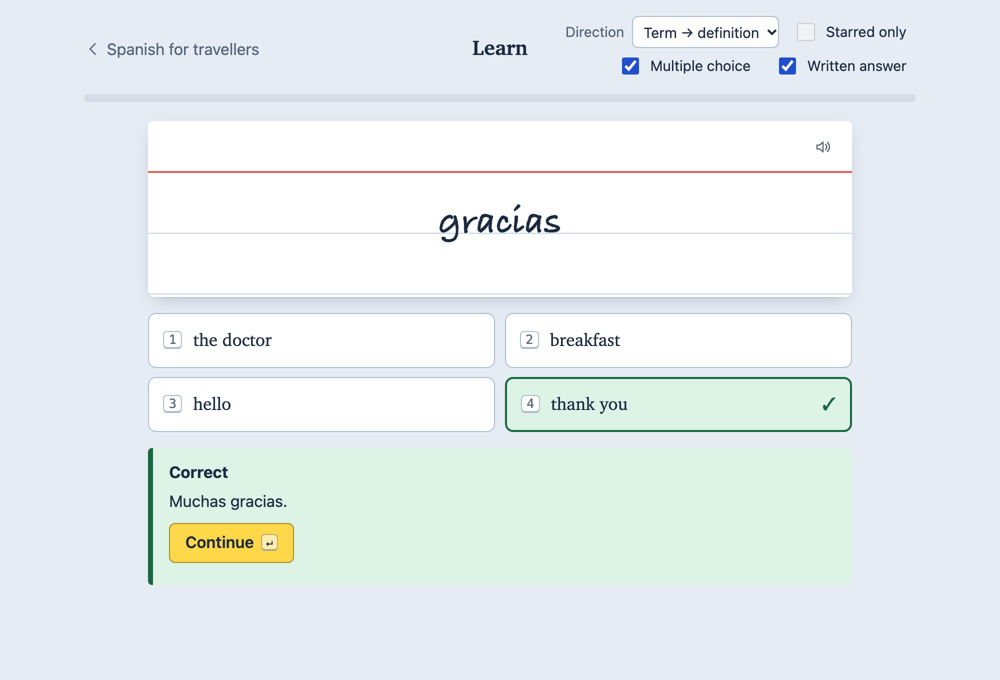

# Flashcard

**English** · [Français](README.fr.md)

**Try it: [kazepoy.github.io/flashcard](https://kazepoy.github.io/flashcard/)**

A free and open-source flashcard and spaced repetition app, an alternative to Quizlet and Anki. It runs
entirely in the browser, offline, with no account and no server: your cards stay with you, in an open
file format.

<p>
  
  
  
  
</p>

## Features

- **Cards**: term / definition, cloze deletion (`{{c1::Paris}}`, as in Anki), image occlusion;
  hint, example, images, audio, Markdown; per-set or per-card look (colours, font, paper, background
  image).
- **Study**: FSRS spaced repetition (daily limits you can bypass, exam plan, suspended cards), flashcards,
  learn, write, spell, test, match, gravity.
- **Assisted creation**: paste lists (Quizlet, spreadsheet), AI generation from a topic, notes or a PDF,
  with an API key or by simple copy and paste with ChatGPT, Claude, Gemini… (files can also be attached
  directly in the assistant).
- **Organisation**: folders, tags, card browser with a search language (`tag:verb is:due -set:english`),
  flags, duplicates, detailed statistics.
- **Exchange**: Anki `.apkg` import / export (image occlusion included), CSV / TSV, Quizlet text,
  Markdown, `.flashcard.zip` archive (imported as a renamed copy or as an update); set sharing; printing
  and PDF of cut-out cards.
- **Sync** (beta): automatic backup and sync between computer, phone and tablet through your
  own Dropbox (a free 2 GB account is more than enough), with no account and no server.
- **Comfort**: 11 light and dark themes, dyslexia-friendly reading fonts (OpenDyslexic, Atkinson
  Hyperlegible, Lexend, Andika), French and English, mobile, installable (PWA).
- **Getting started**: on first launch, a “Guided tour” set shows every card type.

## Your data

Everything stays in the browser (or, on desktop Chrome / Edge, in a folder of your choice). No trackers,
no analytics. Nothing leaves your device unless you ask: sync with your online storage, AI generation,
importing a file from a link.

## Run

```bash
npm install
npm run build && npm run serve   # http://localhost:8080
```

`dist/` is a static site that can be hosted as is (HTTPS is required for installation and folder
access). A GitHub Pages workflow is included.

## Documentation

The technical documentation is in French.

- [docs/DEVELOPMENT.md](docs/DEVELOPMENT.md): architecture, commands, tests, conventions, ideas.
- [docs/SYNC.md](docs/SYNC.md): serverless sync, backup and sharing (services compared).
- [docs/STATS.md](docs/STATS.md): how statistics are computed, and what sync keeps of them.
- [docs/IA.md](docs/IA.md): AI card creation (with or without a key), prompts sent, privacy.
- [docs/SPEC.md](docs/SPEC.md): file format (to read or write a library from another tool).

## Licence

[GNU AGPL-3.0](LICENSE) or later: you may use, modify and redistribute Flashcard,
provided that you publish the code of any modified version under the same licence, even
if it is only offered online.
