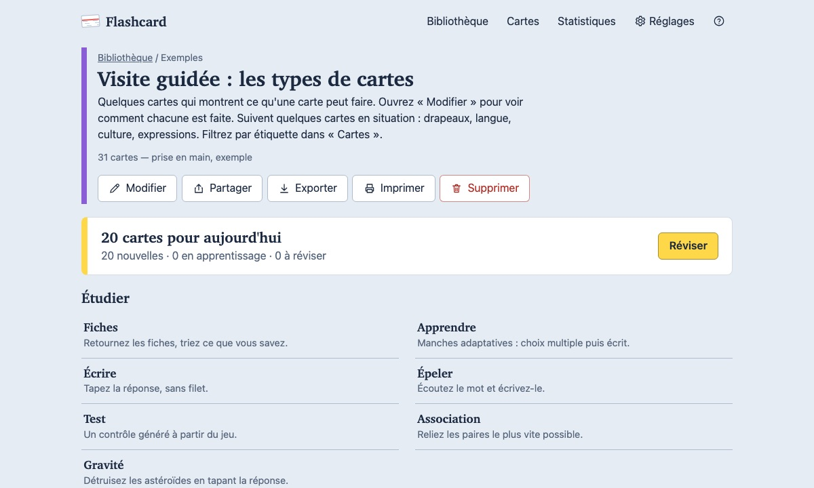
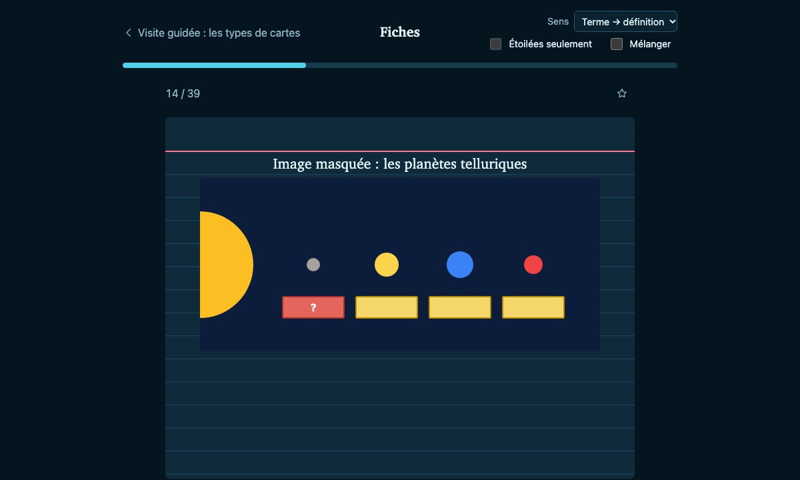

# Flashcard

**Français** · [English](README.en.md)

**Essayer : [kazepoy.github.io/flashcard](https://kazepoy.github.io/flashcard/)**

Application libre de fiches et de révision espacée, alternative à Quizlet et Anki. Elle fonctionne
entièrement dans le navigateur, hors ligne, sans compte ni serveur : vos cartes restent chez vous,
dans un format de fichiers ouvert.

<p>
  
  
</p>

## Fonctionnalités

- **Cartes** : terme / définition, texte à trous (`{{c1::Paris}}`, comme Anki), image masquée ;
  indice, exemple, images, audio, Markdown ; apparence par jeu ou par carte (couleurs, police,
  papier, image de fond).
- **Étude** : révision espacée FSRS (limites du jour contournables, plan d'examen, cartes suspendues), fiches,
  apprendre, écrire, épeler, test, association, gravité.
- **Création assistée** : collage de listes (Quizlet, tableur), génération par IA à partir d'un sujet,
  de notes ou d'un PDF, avec une clé d'API ou par simple copier-coller avec ChatGPT, Claude, Gemini… (fichiers joints
  directement dans l'assistant si besoin).
- **Organisation** : dossiers, étiquettes, navigateur de cartes avec langage de recherche
  (`tag:verbe is:due -set:anglais`), drapeaux, doublons, statistiques détaillées.
- **Échanges** : import / export Anki `.apkg` (image masquée comprise), CSV / TSV, texte Quizlet,
  Markdown, archive `.flashcard.zip` (import en copie renommée ou en mise à jour) ; partage d'un jeu ; impression et PDF de fiches à découper.
- **Synchronisation** (en développement) : sauvegarde automatique et synchronisation entre ordinateur, téléphone et tablette
  via votre propre Dropbox (recommandé pour l'instant ; un compte gratuit de 2 Go suffit largement), Google Drive
  ou OneDrive, sans compte ni serveur.
- **Confort** : 11 thèmes clairs et sombres, polices de lecture adaptées à la dyslexie (OpenDyslexic,
  Atkinson Hyperlegible, Lexend, Andika), français et anglais, mobile, installable (PWA).
- **Prise en main** : à la première ouverture, un jeu « Visite guidée » montre chaque type de carte.

## Vos données

Tout reste dans le navigateur (ou, sur Chrome / Edge de bureau, dans un dossier de votre choix). Aucun
pisteur, aucune mesure d'audience. Rien ne sort sauf à votre demande : synchronisation avec votre stockage
en ligne, génération par IA, import d'un fichier par lien.

## Lancer

```bash
npm install
npm run build && npm run serve   # http://localhost:8080
```

`dist/` est un site statique, hébergeable tel quel (HTTPS requis pour l'installation et l'accès à un
dossier). Un workflow GitHub Pages est fourni.

## Documentation

- [docs/DEVELOPMENT.md](docs/DEVELOPMENT.md) : architecture, commandes, tests, conventions, pistes.
- [docs/SYNC.md](docs/SYNC.md) : synchronisation, sauvegarde et partage sans serveur (services comparés).
- [docs/STATS.md](docs/STATS.md) : comment sont calculées les statistiques, et ce que la synchronisation en garde.
- [docs/IA.md](docs/IA.md) : création de cartes par IA (avec ou sans clé), consignes envoyées, confidentialité.
- [docs/SPEC.md](docs/SPEC.md) : format des fichiers (pour lire ou écrire une bibliothèque depuis un autre outil).

## Licence

[GNU AGPL-3.0](LICENSE) ou ultérieure : vous pouvez utiliser, modifier et redistribuer Flashcard,
à condition de publier sous la même licence le code de toute version
modifiée, même proposée seulement en ligne.
